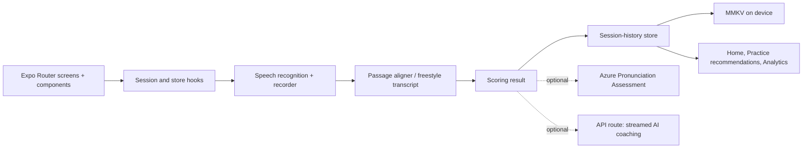

# Clarity repository overview

## Purpose

Clarity is an Expo speech-practice app for iOS and Android. A person reads a supplied or self-authored passage, completes a short drill, or speaks freestyle; the app gives live feedback, scores the session, saves progress locally, and optionally generates AI coaching. The project deliberately has no account system or server database. [README](/Users/onnokleinhofmeijer/dev/sites/clarity/README.md:3) [README](/Users/onnokleinhofmeijer/dev/sites/clarity/README.md:22)

The runtime is Expo SDK 57 / React Native 0.86 with Expo Router; speech recognition and MMKV are native dependencies, so full-device testing needs a development build rather than Expo Go. [package.json](/Users/onnokleinhofmeijer/dev/sites/clarity/package.json:13) [README](/Users/onnokleinhofmeijer/dev/sites/clarity/README.md:35)

## Route and UI structure

Expo Router is the entry point. The root layout loads the bundled fonts, supplies the navigation theme and splash/observability providers, and contains the tabs, the full-screen session modal, and the passage-editor modal. [package.json](/Users/onnokleinhofmeijer/dev/sites/clarity/package.json:4) [root layout](/Users/onnokleinhofmeijer/dev/sites/clarity/app/_layout.tsx:69)

| Route | Screen / role |
| --- | --- |
| `/` | Home: daily goal, suggested passages, and locally derived progress. [home](/Users/onnokleinhofmeijer/dev/sites/clarity/app/(tabs)/index.tsx:26) |
| `/practice` | Practice picker: recommendations, drills, freestyle topics, built-in passages, and custom passages. [practice](/Users/onnokleinhofmeijer/dev/sites/clarity/app/(tabs)/practice.tsx:35) |
| `/analytics` | Week/month/all-time trends, skill metrics, records, and word mastery. [analytics](/Users/onnokleinhofmeijer/dev/sites/clarity/app/(tabs)/analytics.tsx:28) |
| `/session/[passageId]` | Scripted passage or drill recording, teleprompter, live pace, and result persistence. [scripted session](/Users/onnokleinhofmeijer/dev/sites/clarity/app/session/[passageId].tsx:36) |
| `/session/freestyle?topicId=…` | Impromptu recording with a live transcript rather than reference-text alignment. [freestyle session](/Users/onnokleinhofmeijer/dev/sites/clarity/app/session/freestyle.tsx:31) |
| `/session/results` | In-memory result detail, score breakdown, playback, and AI coaching. [results](/Users/onnokleinhofmeijer/dev/sites/clarity/app/session/results.tsx:39) |
| `/passage-editor` | Modal editor that stores a user-authored passage. [root layout](/Users/onnokleinhofmeijer/dev/sites/clarity/app/_layout.tsx:99) |
| `POST /api/speech-coach` | Server API route for streamed structured coaching. [speech-coach route](/Users/onnokleinhofmeijer/dev/sites/clarity/app/api/speech-coach+api.ts:81) |

The tab layout owns the three primary destinations; the session layout owns ephemeral `result`, persisted-record ID, and retry state across the session and results routes. [tab layout](/Users/onnokleinhofmeijer/dev/sites/clarity/app/(tabs)/_layout.tsx:18) [session layout](/Users/onnokleinhofmeijer/dev/sites/clarity/app/session/_layout.tsx:7)

## Runtime architecture and data flow

For a scripted session, the selected hook is real recognition by default (or a build-time mock engine), while the screen owns the start/stop lifecycle. Recognition records WAV segments, advances the teleprompter through transcript-to-passage alignment, and returns a `SessionResult`; the screen records it before navigating to results. [session selection](/Users/onnokleinhofmeijer/dev/sites/clarity/hooks/use-practice-session.ts:1) [scripted session](/Users/onnokleinhofmeijer/dev/sites/clarity/app/session/[passageId].tsx:65) [scripted persistence](/Users/onnokleinhofmeijer/dev/sites/clarity/app/session/[passageId].tsx:96)

Freestyle uses the same recognition lifecycle but intentionally omits the reference-text aligner: committed transcription supplies the live surface, filler count, pace, and a live-proxy result. [freestyle hook](/Users/onnokleinhofmeijer/dev/sites/clarity/hooks/use-freestyle-session.ts:19)

The session flow is resilient to interruption: a checkpoint is written at start, every five seconds while listening, and when the app backgrounds; stale checkpoints are recovered as interrupted sessions by the history store. [checkpoint hook](/Users/onnokleinhofmeijer/dev/sites/clarity/hooks/use-session-checkpoint.ts:32) [history binding](/Users/onnokleinhofmeijer/dev/sites/clarity/services/session-history.ts:34)

`recordSession` reduces detailed word verdicts into compact counts and challenging words before delegating persistence. React screens subscribe synchronously to that store with `useSyncExternalStore`, then compute stats and recommendations from the saved records rather than duplicating server state. [recording boundary](/Users/onnokleinhofmeijer/dev/sites/clarity/services/session-history.ts:66) [history hooks](/Users/onnokleinhofmeijer/dev/sites/clarity/hooks/use-session-history.ts:18)

## Persistence and integrations

- **On-device data:** `services/kv.ts` resolves one shared MMKV backend and falls back to volatile in-memory storage if its native binding is missing. Session history supplies validation, migration, quarantine, checkpoint recovery, import/export, and subscriptions through the pure `lib/history-store.ts` module. [KV resolver](/Users/onnokleinhofmeijer/dev/sites/clarity/services/kv.ts:19) [history service](/Users/onnokleinhofmeijer/dev/sites/clarity/services/session-history.ts:1)
- **Custom content:** user passages are stored one MMKV key per passage, synchronously hydrated, validated entry by entry, and migrated from the prior JSON file format. [user-passage store](/Users/onnokleinhofmeijer/dev/sites/clarity/services/user-passages.ts:102) [passage writes](/Users/onnokleinhofmeijer/dev/sites/clarity/services/user-passages.ts:154)
- **Speech recognition and audio:** the app config declares microphone/speech-recognition permissions and the recognition plugin. Recorded 16 kHz PCM WAV is used for optional assessment. [app config](/Users/onnokleinhofmeijer/dev/sites/clarity/app.json:13) [Azure client](/Users/onnokleinhofmeijer/dev/sites/clarity/services/azure-pronunciation.ts:126)
- **Azure Speech (optional):** the client posts short WAV chunks plus the reference text to Azure’s pronunciation-assessment REST endpoint. Any failed chunk resolves to `null`, allowing scoring to fall back rather than dead-ending the session. [Azure client](/Users/onnokleinhofmeijer/dev/sites/clarity/services/azure-pronunciation.ts:126) [README](/Users/onnokleinhofmeijer/dev/sites/clarity/README.md:59)
- **AI coaching (optional):** the client sends a bounded, aggregated session-stat payload to the relative API route and progressively parses its streamed JSON. The server validates it with Zod, requires an AI Gateway/OIDC credential, and streams a schema-constrained three-tip response from the configured model. [client](/Users/onnokleinhofmeijer/dev/sites/clarity/services/ai-coaching.ts:119) [server route](/Users/onnokleinhofmeijer/dev/sites/clarity/app/api/speech-coach+api.ts:81)
- **Updates and observability:** `app.config.ts` supplies variant-specific bundle IDs/schemes and the EAS Updates URL; `app/_layout.tsx` configures Expo Observe’s router integration. [variant config](/Users/onnokleinhofmeijer/dev/sites/clarity/app.config.ts:55) [observability](/Users/onnokleinhofmeijer/dev/sites/clarity/app/_layout.tsx:17)

## Module boundaries

The intended dependency direction is: constants and `lib/` are pure; `services/` binds side effects; hooks adapt services and pure calculations to React; components render them; `app/` files assemble routes and navigation. This is documented in the repository and visible in the history service’s dependency-injected store binding. [README](/Users/onnokleinhofmeijer/dev/sites/clarity/README.md:71) [history service](/Users/onnokleinhofmeijer/dev/sites/clarity/services/session-history.ts:1)

## Build, delivery, and tests

The package `test` script (run as `bun run test`) chains four Bun scripts covering history, statistics, alignment, and WAV/scoring behavior; the scripts target pure modules instead of a React Native runtime. `bun test` invokes Bun's test-file discovery instead and does not run this package script. [package scripts](/Users/onnokleinhofmeijer/dev/sites/clarity/package.json:51) [README](/Users/onnokleinhofmeijer/dev/sites/clarity/README.md:62)

The app has development, preview, and production EAS profiles. Development uses an internal development client; preview is an internal distribution on the `preview` channel; production auto-increments its version. [EAS configuration](/Users/onnokleinhofmeijer/dev/sites/clarity/eas.json:6)
